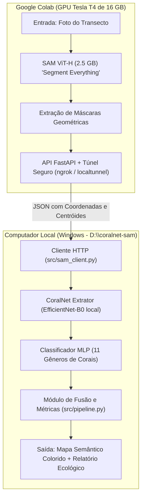
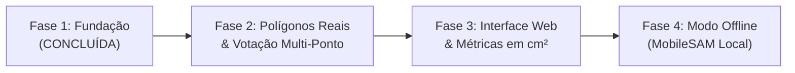

# 🪸 Plano Mestre de Engenharia: Pipeline Automatizado SAM ➔ CoralNet

> **Documento de Especificação Técnica e Guia de Continuidade**  
> **Repositório do Projeto:** `D:\coralnet-sam`  
> **Status:** Fase 1 e Fase 2 Concluídas (Fundação, RLE/Polígonos, NMS Hierárquico e Votação Multi-Ponto operacionais)

---

## 1. Visão Geral e Objetivo

### 1.1 O Problema Atual
- O **CoralNet** tradicional é restrito à **amostragem pontual** (*Point-based Sampling*): prevê rótulos ecológicos apenas em pontos sorteados, sem delimitar as bordas das colônias ou medir áreas reais.
- O **Segment Anything Model (SAM)** da Meta AI é o estado da arte em delimitar contornos e polígonos de qualquer objeto, mas é **agnóstico de classe** (*Class-Agnostic*): não sabe se o objeto segmentado é uma *Mussismilia*, *Montastraea* ou alga.

### 1.2 A Solução: Pipeline Inverso "SAM ➔ CoralNet"
Criar um pipeline **100% automatizado (Zero Cliques Humanos)** que une o melhor dos dois mundos:
1. **O SAM** descobre e contorna todas as colônias e áreas da foto do transecto;
2. **O CoralNet** analisa os centróides e texturas de cada colônia delimitada e atribui o gênero/espécie biológico;
3. O sistema gera **mapas de segmentação semântica pixel a pixel** e métricas ecológicas exatas (área em $\text{cm}^2$, contagem de colônias e % de cobertura bêntica).

---

## 2. Arquitetura do Sistema (Híbrida Nuvem + Local)

Como a máquina de desenvolvimento possui GPU com **2 GB de VRAM**, a arquitetura foi desenhada em formato **Cliente-Servidor (Microserviço)**:



---

## 3. Taxonomia e Classes Alvo

O classificador local (`src/coral_classifier.py`) está parametrizado para os **11 principais gêneros de corais do Atlântico Sul / Brasil** e principais substratos de competição:

| ID | Classe / Gênero | Família | Cor HEX | Características Visuais Principais |
| :---: | :--- | :--- | :---: | :--- |
| 1 | **`Montastraea`** | Montastraeidae | `#e6194b` | Cálices cônicos elevados gigantes ("olhos"). |
| 2 | **`Mussismilia`** | Faviidae / Mussidae | `#3cb44b` | Vales meandroides carnudos largos, septos dentados. |
| 3 | **`Porites`** | Poritidae | `#ffe119` | Superfície rugosa/ondulada, colônias mostarda/verde. |
| 4 | **`Siderastrea`** | Siderastreidae | `#4363d8` | Padrão cerioide estrelado em "favo de mel". |
| 5 | **`Agaricia`** | Agariciidae | `#f58231` | Cristas e vales folhosos/reticulados ("alface"). |
| 6 | **`Millepora`** | Milleporidae | `#911eb4` | Hidrocoral liso sem cálices, galhos com pontas claras. |
| 7 | **`Madracis`** | Pocilloporidae | `#42d4f4` | Ramos e nódulos com cálices estrelados de 10 septos. |
| 8 | **`Meandrina`** | Meandriniidae | `#f032e6` | Vales contínuos retos em leque com septos altos. |
| 9 | **`Stephanocoenia`**| Astrocoeniidae | `#bfef45` | Cálices hexagonais pequenos regulares com centro escuro. |
| 10 | **`Scolymia`** | Faviidae / Mussidae | `#fabed4` | Coral discoide solitário carnoso monocêntrico. |
| 11 | **`Favia`** | Faviidae | `#469990` | Colônias plocoides pequenas com paredes separadas. |
| 12 | **`Algae`** | - | `#9a6324` | Macroalgas carnosas, tufos de *turf* e algas coralinas (CCA). |
| 13 | **`Hard Substrate`**| - | `#808080` | Rocha nua, pavimento calcário e escombros consolidados. |
| 14 | **`Soft Substrate`**| - | `#fffac8` | Sedimento móvel, areia fina e cascalho solto (*rubble*). |
| 15 | **`Other Invertebrates`** | - | `#aaffc3` | Esponjas marinhas, zoantídeos e octocorais. |

---

## 4. Estrutura de Arquivos e Componentes

O projeto local está totalmente isolado em **`D:\coralnet-sam`**:

```text
D:\coralnet-sam\
├── colab/
│   └── sam_server_colab.ipynb   # Notebook pronto para executar no Google Colab
├── models/
│   ├── efficientnet_b0_ver1.pth # Pesos locais do CoralNet (21.4 MB)
│   └── .gitkeep
├── images/                      # 8 fotos de pesquisa para testes práticos
│   ├── 10.0_P5112664.JPG
│   └── ... (2.0 a 9.0)
├── src/
│   ├── sam_client.py            # Comunicação HTTP com o Colab (envio de foto e recepção de máscaras)
│   ├── coral_classifier.py      # Extração de características e classificação taxonômica local
│   └── pipeline.py              # Algoritmo de fusão, cálculo de métricas e renderização gráfica
├── output/                      # Diretório onde os mapas semânticos são gravados
├── run_pipeline.py              # CLI de execução ponta a ponta
├── requirements.txt             # Dependências locais (requests, torch, torchvision, pillow, matplotlib)
├── .gitignore                   # Protege o Git de arquivos pesados
└── README.md                    # Documentação operacional
```

---

## 5. Especificação Técnica dos Módulos

### 5.1 Módulo do Servidor Remoto (Google Colab)
- **Arquivo:** `colab/sam_server_colab.ipynb`
- **Modelo:** `sam_vit_h_4b8939.pth` (2.5 GB) em modo `SamAutomaticMaskGenerator`.
- **Hiperparâmetros otimizados para corais:**
  - `points_per_side = 32`: Grade densa de 1.024 pontos de sondagem inicial.
  - `pred_iou_thresh = 0.86`: Elimina máscaras de contorno incerto.
  - `stability_score_thresh = 0.90`: Garante contornos estáveis sob diferentes limiares.
  - `min_mask_region_area = 200`: Ignora ruídos menores que 200 pixels.
- **API:** FastAPI expondo `POST /segment` que retorna os metadados das máscaras em JSON compactado via túnel `ngrok`.

### 5.2 Módulo do Classificador Local
- **Arquivo:** `src/coral_classifier.py`
- **Backbone:** `EfficientNet-B0` carregando os pesos locais `models/efficientnet_b0_ver1.pth`.
- **Operação:**
  - Recebe os centróides `(cy, cx)` de cada máscara do SAM;
  - Extrai patches de $224 \times 224$ pixels;
  - Processa em lotes seguros (`batch_size=16`, consumo $< 800\text{ MB}$ de VRAM);
  - Devolve probabilidade máxima e candidatos secundários.

### 5.3 Módulo de Fusão e Métricas
- **Arquivo:** `src/pipeline.py`
- **Lógica de Métricas:**
  - Área de cada colônia em pixels: $A_i = \text{pixels da máscara}$;
  - Área total da foto: $A_{total} = W \times H$;
  - Cobertura percentual de cada gênero: $\% \text{Cover}_g = \frac{\sum_{i \in g} A_i}{A_{total}} \times 100$;
  - Contagem de colônias individuais (*Instance Count*).

---

## 6. Roadmap para o Próximo Agente



### ✅ Fase 1: Fundação do Projeto (Concluída)
- [x] Criação do repositório limpo em `D:\coralnet-sam`.
- [x] Cópia dos pesos locais do CoralNet (`models/efficientnet_b0_ver1.pth`).
- [x] Criação do notebook Google Colab com SAM ViT-H e túnel ngrok.
- [x] Implementação do pipeline de teste com centróides e classificação taxonômica.

---

### ✅ Fase 2: Polígonos Reais e Votação Multi-Ponto (Concluída)
- [x] **Transmissão e Desenho de Polígonos:** Extração de contornos vetoriais com OpenCV e serialização RLE compacta (`colab/sam_server_colab.ipynb` e `src/sam_client.py`).
- [x] **Classificação Multi-Ponto por Colônia (*Multi-point Voting*):** Amostragem de até 5 pontos internos em colônias grandes com agregação probabilística e votação por maioria (`src/coral_classifier.py` e `src/geometry.py`).
- [x] **Resolução de Sobreposição de Máscaras (*Hierarchical NMS*):** Supressão inteligente de fragmentos e caixas duplicadas por IoU e taxa de contenção (`src/geometry.py`).
- [x] **Validação em Foto Real de 12 Megapixels:** Teste bem-sucedido com supressão de 134 redundâncias e mapeamento de 300 colônias refinadas.

---

### 📋 Fase 3: Interface Web Unificada e Métricas Físicas em $cm^2$
1. **Adaptar a Interface Web para Máscaras do SAM:**
   - Adicionar na interface web (`app.py`) a opção de colar a URL do Colab.
   - Renderizar polígonos SVG semi-transparentes cobrindo cada colônia contornada.
2. **Cálculo de Área Real ($cm^2$):**
   - Permitir informar a escala física (ex: tamanho do quadrante de amostragem em $cm$ ou $mm$ por pixel).
   - Exibir o relatório: *"Colônia #3 (Mussismilia): $248.5\text{ cm}^2$"*.
3. **Exportação de Dados:**
   - Botão para exportar relatório em **CSV** (ID, Gênero, Área em $cm^2$, Confiança, Coordenadas) e máscaras em formato **GeoTIFF / PNG**.

---

### 📋 Fase 4: Modo Offline sem Colab (MobileSAM Local)
1. **Adicionar suporte ao MobileSAM (`TinyViT`):**
   - Criar opção de fallback local: se o usuário estiver sem internet ou sem Colab, o pipeline usa o `MobileSAM` (39 MB) diretamente na GPU local de 2 GB.
   - Permite que o software funcione 100% desconectado em viagens de campo a bordo de barcos de pesquisa.

---

## 7. Instruções Rápidas de Execução para o Agente

Para rodar e testar o estado atual do projeto:

```powershell
# 1. Navegar até o diretório do projeto
cd D:\coralnet-sam

# 2. Executar o teste de validação local (com pesos offline do CoralNet)
d:\coralnet-inference\.venv\Scripts\python.exe run_pipeline.py --image images/10.0_P5112664.JPG

# 3. Executar com o servidor Colab conectado (quando a URL do ngrok estiver ativa)
d:\coralnet-inference\.venv\Scripts\python.exe run_pipeline.py --image images/10.0_P5112664.JPG --sam-url https://xxxx.ngrok-free.app
```
