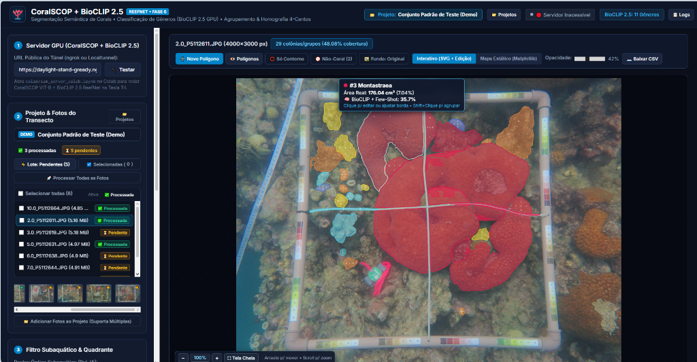

# CoralSCOP + BioCLIP 2.5 ReefNet 🌊

> **Segmentação Semântica de Alta Precisão & Classificação Taxonômica de Corais do Atlântico Sul**  
> *Pipeline Híbrido: Google Colab GPU (Tesla T4) + Dashboard Web Interativo Local (Flask & SVG)*

[](https://www.python.org/)
[-emerald.svg)](https://github.com/zhengziqiang/CoralSCOP)
[-teal.svg)](https://github.com/Imageomics/bioclip)
[]()

<p align="center">
  
</p>

---

## 🌊 Visão Geral

O **CoralSCOP + BioCLIP 2.5 ReefNet** é uma plataforma completa para pesquisadores, biólogos marinhos e ecólogos realizarem levantamentos quantitativos em transectos de recifes de coral brasileiros (Abrolhos, Recife de Fora, Fernando de Noronha, etc.).

O sistema elimina o trabalho manual exaustivo de marcação ponto a ponto, oferecendo:
1. **Segmentação Automática**: Delimitação exata dos contornos de 100% das colônias via **CoralSCOP ViT-B** (modelo treinado especificamente em corais).
2. **Taxonomia Multi-Escala**: Classificação dos **11 gêneros estritos do Atlântico Sul** via **BioCLIP 2.5 ViT-H/14**, analisando a forma macro da colônia combinada com a textura micro dos coralitos em alta resolução 4K.
3. **Métricas Físicas Reais**: Homografia de perspectiva por 4 cantos para compensar ângulo e distância da câmera submarina, calculando **área real em cm²** e **% de cobertura**.
4. **Trabalho por Projetos Estruturados**: Criação de projetos organizados fora do repositório, garantindo a integridade e separação de fotos e anotações.
5. **Processamento em Lote & Exportação**: Execução foto a foto ou em lote com planilha consolidada do projeto (`project_ecological_summary.csv`).

---

## 🏗️ Arquitetura do Sistema

```text
┌────────────────────────────────────────────────────────┐         ┌────────────────────────────────────────────────────────┐
│               COMPUTADOR LOCAL (Dashboard Web)         │         │               GOOGLE COLAB (Cloud GPU Tesla T4)        │
│               [d:\coralnet-sam]                        │         │               [colab/sam_server_colab.ipynb]           │
├────────────────────────────────────────────────────────┤         ├────────────────────────────────────────────────────────┤
│ 1. Filtro Óptico (CLAHE + White Balance)               │         │ 1. CoralSCOP ViT-B (CVPR 2024)                         │
│ 2. Demarcação dos 4 Cantos do Quadrante (Homografia)   │  HTTP   │    - Segmentação dos contornos de cada colônia         │
│ 3. Envia foto e parâmetros via túnel ──────────────────┼────────►│ 2. BioCLIP 2.5 ViT-H/14 ReefNet (Multi-Escala)          │
│ 4. Recebe polígonos, gêneros e embeddings de 512-dim ◄─┼─────────┤    - Extração de coralitos (224×224 a 4K)              │
│ 5. Dashboard SVG Interativo, Agrupamento e Edição      │ (ngrok) │    - Probabilidades taxonômicas dos 11 gêneros         │
│ 6. Gravação com Hash SHA-256 e Relatórios CSV          │         │    - Vetor de características L2-normalizado           │
└────────────────────────────────────────────────────────┘         └────────────────────────────────────────────────────────┘
```

---

## 🏷️ Taxonomia Suportada (Gêneros do Atlântico Sul)

O classificador é restrito exclusivamente aos 11 gêneros de corais construtores e hidrocorais do litoral brasileiro, além do rótulo negativo para descarte:

| Cor | Gênero | Exemplo Típico |
|:---:|:---|:---|
| 🟨 | **Mussismilia** | *Mussismilia harttii, M. hispida, M. braziliensis* (Coral-cérebro endêmico) |
| 🟦 | **Montastraea** | *Montastraea cavernosa* |
| 🟩 | **Porites** | *Porites astreoides, Porites branneri* |
| 🟪 | **Siderastrea** | *Siderastrea stellata* |
| 🟧 | **Agaricia** | *Agaricia fragilis, Agaricia humilis* |
| 🟫 | **Millepora** | *Millepora alcicornis, M. braziliensis* (Coral-de-fogo) |
| 🩵 | **Madracis** | *Madracis decactis* |
| 🌸 | **Meandrina** | *Meandrina brasiliensis* |
| 🟢 | **Stephanocoenia** | *Stephanocoenia intersepta* |
| 🔴 | **Scolymia** | *Scolymia wellsi* |
| 🟣 | **Favia** | *Favia gravida* |
| ⚪ | **Não é Coral (Descartar)** | Falsos positivos, algas calcárias, esponjas, canos de PVC |

---

## 📁 Gestão por Projetos & Hash Criptográfico (SHA-256)

Ao clicar em **📁 Projetos** no topo do dashboard, você pode criar projetos independentes em qualquer diretório do computador (fora do repositório de código):

```text
📁 C:\Meus_Projetos_Corais\Abrolhos_2026/
├── 📄 coralscop_project.json           # Identificador oficial do projeto
├── 📁 raw_images/                      # Fotos submarinas originais
├── 📁 filtered_images/                 # Fotos com realce óptico pré-IA
├── 📁 polygons/                        # Polígonos vinculados por hash SHA-256
└── 📁 exports/                         # Mapas de alta resolução e relatórios CSV
```

### 🔒 Proteção por Hash SHA-256
* Cada arquivo de anotação é salvo no formato `polygons/<stem>_<sha12>_polygons.json`.
* Se uma foto for substituída por outro arquivo com o **mesmo nome** na pasta `raw_images/`, o sistema calcula o novo SHA-256, percebe a divergência, descarta as marcações antigas e avisa na tela com o status `⚠️ Imagem alterada`.
* Fotos já processadas têm status `✅ Processada` e carregam **instantaneamente** ao serem selecionadas, sem reprocessar na GPU.

---

## ⚙️ Como Executar

### 1. Iniciar o Servidor GPU no Google Colab
1. Abra o [Google Colab](https://colab.research.google.com/).
2. Faça upload do notebook [`colab/sam_server_colab.ipynb`](file:///colab/sam_server_colab.ipynb).
3. Certifique-se de selecionar GPU T4 (**Ambiente de Execução > Alterar tipo de ambiente de execução > GPU T4**).
4. Execute todas as células em ordem. A última célula fornecerá a URL pública gerada pelo túnel (ngrok ou Localtunnel), por exemplo:  
   `👉 https://xxxx.ngrok-free.dev`

### 2. Iniciar o Dashboard Web Local
No terminal (PowerShell no Windows):

```powershell
cd d:\coralnet-sam

# Ative o ambiente virtual
.\.venv\Scripts\Activate.ps1

# Inicie o dashboard Flask
python app.py
```

Abra o navegador em: **`http://localhost:5000`**

Cole a URL do Colab no Passo 1 e clique em **🔌 Testar Conexão**. Quando o badge ficar verde, você está pronto para processar!

---

## 🕹️ Funcionalidades do Dashboard Interativo

### Processamento Individual ou em Lote
* **⚡ Executar CoralSCOP ➔ BioCLIP 2.5**: Processa a foto ativa no canvas.
* **⚡ Lote: Pendentes**: Executa em fila apenas as fotos que ainda não foram processadas ou cujo arquivo de imagem foi alterado.
* **☑️ Selecionadas**: Marque as caixas de seleção na lista e processe apenas as fotos desejadas.
* **🚀 Processar Todas as Fotos**: Processamento geral de todo o conjunto.
* **📊 CSV Geral**: Baixa a planilha consolidada com os índices ecológicos de todas as fotos verificadas do projeto.

### Pós-Processamento e Curadoria no Canvas
* **Agrupamento de Colônias (`Shift + Clique`)**: Selecione vários polígonos do mesmo gênero para fundi-los em uma única colônia (útil para colônias ramificadas ou fragmentadas).
* **Desmembramento de Grupos**: Remova subpartes individuais de um grupo quando necessário.
* **Demarcação Manual de Polígonos (`➕ Novo Polígono` / Tecla `N`)**:
  * Clique ponto a ponto ou segure `Shift + Arrastar` para traçar o contorno livre com laço suave.
  * O BioCLIP 2.5 na GPU classifica o polígono desenhado imediatamente!
* **Edição Fina de Vértices**: Clique em qualquer polígono e selecione **✏️ Editar Bordas** para arrastar vértices ou adicionar novos pontos usando alças azuis.
* **Visibilidade Rápida (`Tecla V`)**: Oculte os polígonos momentaneamente para inspecionar os coralitos da foto sem obstrução visual.
* **Zoom Suave & Pan**: Use o scroll do mouse centralizado no cursor e arraste a imagem livremente. Pressione `0` para restaurar e `F` para alternar Tela Cheia.
* **Memória Few-Shot**: Ensine novas assinaturas visuais ou filtre "Não é Coral" com 1 clique; o sistema calcula similaridade de cosseno nos vetores de 512 dimensões.

---

## ⌨️ Atalhos de Teclado

| Tecla | Ação |
|:---:|:---|
| `V` | Alternar visibilidade de todos os polígonos |
| `N` | Iniciar demarcação de um novo polígono manual |
| `F` | Expandir / recolher o canvas em Tela Cheia |
| `0` | Centralizar a foto e restaurar o zoom para 100% |
| `+` / `-` | Aumentar ou diminuir o zoom |
| `Esc` | Fechar gavetas de inspeção, cancelar demarcação ou sair de tela cheia |
| `Ctrl + Z` | Desfazer último vértice na demarcação manual ou edição de bordas |
| `Shift + Clique` | Adicionar polígono à seleção de agrupamento |
| `Shift + Arraste` | Laço contínuo estilo caneta na demarcação manual |

---

## 📊 Estrutura dos Arquivos de Saída

### 1. Planilha Consolidada (`project_ecological_summary.csv`)
Gera a tabela completa do levantamento com:
* Nome do arquivo e hash SHA-256 verificado.
* Área física total do quadrante ($cm^2$).
* Área total e porcentagem de cobertura bêntica de coral vivo.
* Desdobramento de área ($cm^2$) e cobertura (%) para cada um dos 11 gêneros.

### 2. Mapa Estático em Alta Definição (Matplotlib)
Disponível na aba **"Mapa Estático"**, renderiza a figura pronta para publicação científica com legenda de gêneros, contornos e escala métrica.

---

## 📜 Licença e Citações

Desenvolvido para pesquisa científica e monitoramento de recifes de coral.  
Se utilizar este software em pesquisas ou publicações, cite os trabalhos fundamentais:
* **CoralSCOP**: [Foundation Model for Coral Reef Segmentation](https://github.com/zhengziqiang/CoralSCOP) (CVPR 2024).
* **BioCLIP**: [A Vision Foundation Model for the Tree of Life](https://github.com/Imageomics/bioclip) (CVPR 2024).
